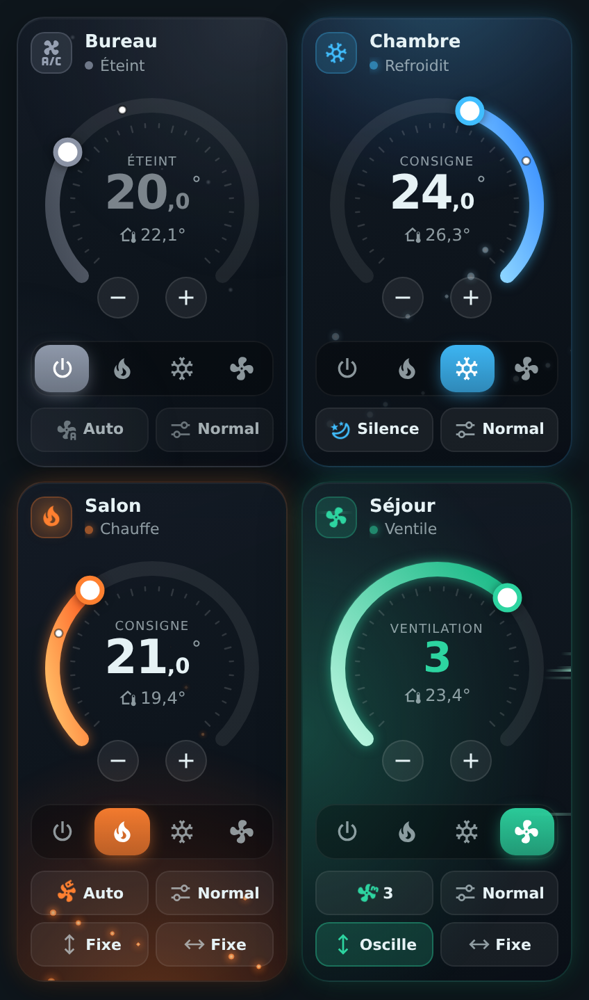
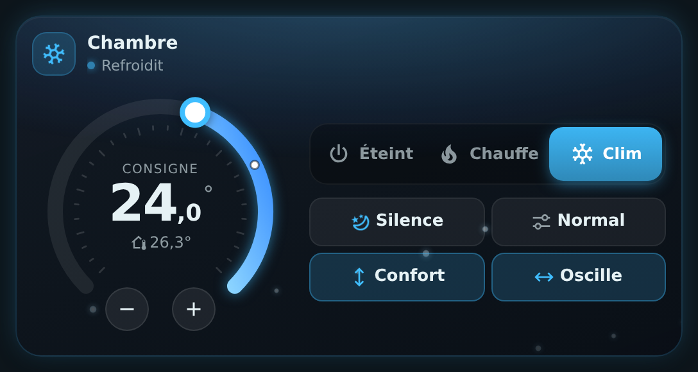
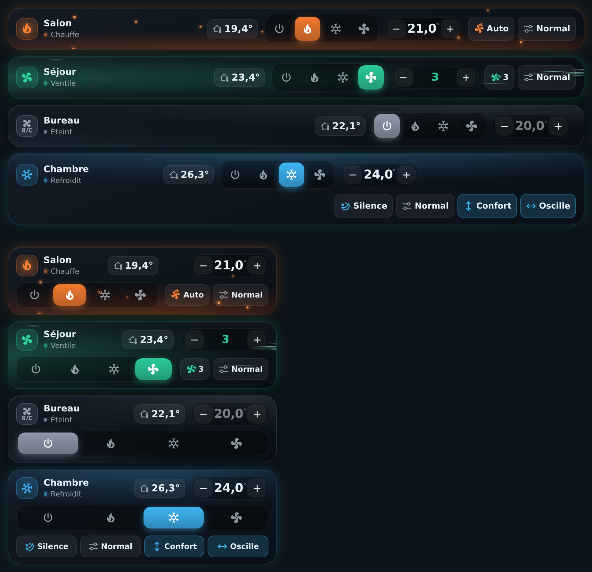
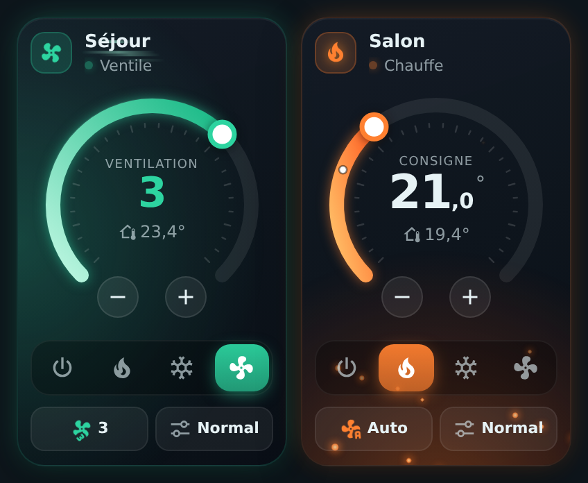
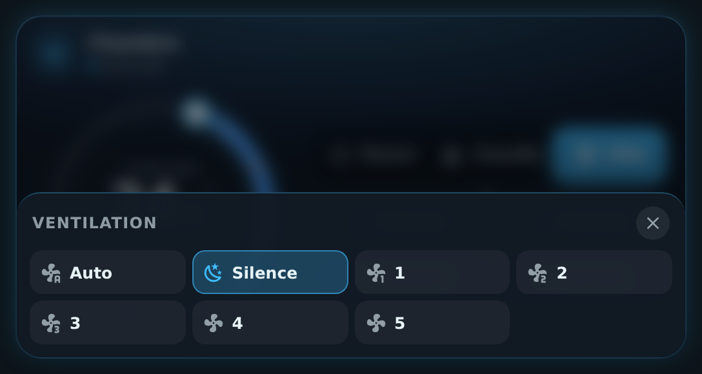
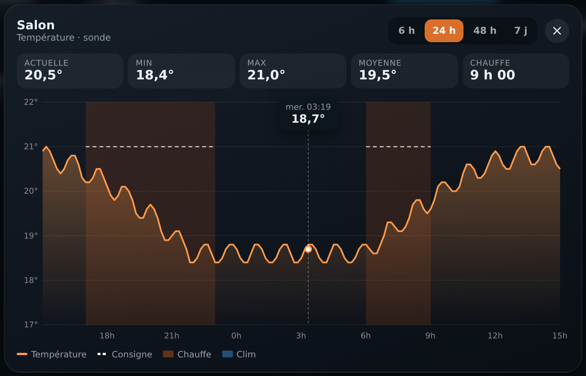

# 🌡️ HOLM Climate Card

[](https://hacs.xyz/)


**Une carte clim / chauffage compacte et vivante : on voit tout de suite si ça chauffe, si ça refroidit, et on règle la consigne d'un geste.**

HOLM Climate Card remplace la carte thermostat pour vos entités `climate` (climatiseurs, pompes à chaleur, radiateurs connectés…). Elle tient à **deux côte à côte sur un téléphone**, s'étale joliment en **pleine largeur**, et son ambiance change selon ce que fait l'appareil : **braises** qui montent quand il chauffe, **flocons** quand il refroidit, brume grise qui respire quand il est éteint.

> ✨ **Zéro YAML.** On l'ajoute depuis le sélecteur de cartes, on choisit son appareil : c'est prêt.

### En bref

- 🔥❄️ **Ambiance selon l'usage** : lueur chaude et braises en chauffage, lueur froide et flocons en clim, animations **seulement quand l'appareil chauffe ou refroidit réellement** (sinon lueur apaisée).
- 🎯 **Roue de consigne 270°** : on fait glisser le curseur, ou on ajuste au demi-degré avec − / +. La température actuelle est repérée sur la roue.
- 🔘 **Modes en pastilles** : Éteint / Chauffage / Clim / **Ventilation** (si l'appareil sait ventiler), et le mode en cours s'il est différent (chaud / froid, déshumidification).
- 🌬️ **Mode ventilation** : couleur vert d'eau, filets d'air qui traversent la carte ; sans consigne de température, la roue et les boutons − / + règlent la **vitesse de ventilation**.
- 🌀 **Ventilation, préréglage, oscillation** verticale et horizontale : des puces compactes qui ouvrent un volet de choix. Seules les options que l'appareil connaît sont proposées.
- ⚡ **Réponse immédiate** : l'écran change tout de suite, sans attendre l'appareil (idéal avec les clims pilotées par le cloud, souvent lentes à répondre).
- 📱 **Deux tailles** : compacte (2 cartes par ligne sur mobile) ou large (roue à gauche, commandes à droite), automatiquement selon la place disponible.
- 📏 **Vue compacte** (`layout: compact`) : sans la roue et très basse — la consigne − / + est au niveau du nom, les modes et options juste dessous ; en pleine largeur tout tient sur **une seule ligne**. S'adapte à la place disponible (options en icônes sur les cartes très étroites).
- 🌡️ **Sonde au choix** et **graphique** : la température peut venir d'un autre capteur ; un toucher dessus ouvre l'historique (24 h par défaut, 6 h / 48 h / 7 j) avec la consigne et les périodes de chauffe / clim.
- 🔒 **Consignes mini / maxi** : bornez la roue et les boutons (ex. 18 à 23 °C).
- 👆 Un toucher sur le nom ouvre la fiche de l'appareil dans Home Assistant ; un toucher sur la température ouvre son historique.

| Deux côte à côte (chauffage / clim) | Pleine largeur |
|---|---|
|  |  |

**Vue compacte** (`layout: compact`)



**Mode ventilation** (la roue règle la vitesse)



| Volet de choix (ventilation) | Historique de la température |
|---|---|
|  |  |

---

## Installation

### Avec HACS (recommandé)

1. HACS → menu ⋮ → **Dépôts personnalisés**.
2. Ajoutez `https://github.com/kaaribou/climate-card-holm`, catégorie **Tableau de bord** (*Dashboard / Plugin*).
3. Recherchez **HOLM Climate Card** → **Télécharger**.
4. Rechargez la page (Ctrl + F5).

### Manuellement

1. Copiez `dist/holm-climate-card.js` dans `config/www/community/holm-climate-card/`.
2. **Paramètres → Tableaux de bord → ⋮ → Ressources → Ajouter** : `/local/community/holm-climate-card/holm-climate-card.js`, type **Module JavaScript**.
3. Rechargez la page.

---

## Utilisation

Ajoutez la carte **HOLM Climate** depuis le sélecteur de cartes et choisissez votre appareil.

```yaml
type: custom:holm-climate-card
entity: climate.salon
```

Dans un tableau de bord en sections, la carte prend par défaut une demi-largeur : **deux cartes par ligne**. Élargissez-la (12 colonnes) pour la présentation pleine largeur.

---

## Options

| Option | Description | Par défaut |
|---|---|---|
| `entity` | Entité `climate` (**obligatoire**) | — |
| `name` | Nom affiché | nom de l'appareil |
| `icon` | Icône quand l'appareil est éteint | `mdi:air-conditioner` |
| `show_fan` | Puce **Ventilation** | `true` |
| `show_preset` | Puce **Préréglage** (boost, absence, éco…) | `true` |
| `show_swing` | Puces **Oscillation** verticale et horizontale | `true` |
| `layout` | `full` (avec la roue) ou `compact` (en largeur, sans la roue) | `full` |
| `min_temp` / `max_temp` | Consigne minimum / maximum autorisée (dans les limites de l'appareil) | limites de l'appareil |
| `temperature_sensor` | Sonde de température affichée (sinon celle de l'appareil) | — |
| `graph_hours` | Durée du graphique à l'ouverture (heures) | `24` |

```yaml
type: custom:holm-climate-card
entity: climate.chambre
name: Chambre
show_swing: false
```

Vue compacte avec une sonde et une plage de consigne :

```yaml
type: custom:holm-climate-card
entity: climate.bureau
layout: compact
temperature_sensor: sensor.bureau_temperature
min_temp: 18
max_temp: 24
```

Un toucher sur la **température actuelle** ouvre l'historique : température (ou sonde), consigne en pointillés, périodes de chauffe et de clim, minimum / maximum / moyenne et durée de fonctionnement.

---

## FAQ / dépannage

| Problème | Solution |
|---|---|
| Une puce n'apparaît pas | L'appareil ne propose pas cette option à Home Assistant (ex. pas de modes de ventilation sur un radiateur). |
| Les animations ne se lancent pas | Elles ne tournent que quand l'appareil **chauffe ou refroidit réellement** (`hvac_action`). En veille, la lueur reste apaisée. Elles sont aussi coupées si votre système demande de réduire les animations. |
| La consigne revient en arrière | L'appareil n'a pas accepté la valeur (hors plage min / max) : la carte réaffiche la valeur réelle au bout d'une vingtaine de secondes. |
| La nouvelle version ne s'affiche pas | Videz le cache (Ctrl + F5, ou « Recharger les ressources » dans l'application mobile). |

---

## Un petit merci ?

La carte vous plaît ? Vous pouvez m'offrir une bière 🍺

[](https://paypal.me/kaaribou)

---

## Licence

Code : licence **MIT** — © kaaribou. Voir le [CHANGELOG](CHANGELOG.md).

Fait partie de la collection **HOLM** : [Carburant HOLM](https://github.com/kaaribou/carburant-holm) · [HOLM Navbar Card](https://github.com/kaaribou/holm-navbar-card) · [HOLM Music Card](https://github.com/kaaribou/holm-music-card) · [HOLM Sentinel Card](https://github.com/kaaribou/holm-sentinel-card).
